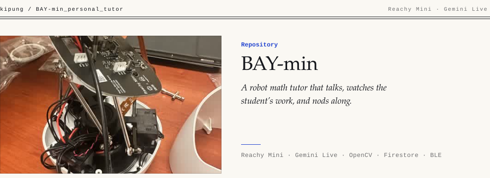

<picture><source media="(max-width: 640px) and (prefers-color-scheme: dark)" srcset=".github/banner-m-dark.svg"><source media="(max-width: 640px)" srcset=".github/banner-m-light.svg"><source media="(prefers-color-scheme: dark)" srcset=".github/banner-dark.svg"></picture>

**BAY-min** is a friendly robot math tutor for elementary students, built on the [Reachy Mini](https://github.com/pollen-robotics/reachy_mini) robot. It holds a spoken conversation through Gemini Live, looks down at the student's work through its camera when it needs to check an answer, keeps its head turned toward the student, and reacts with expressions from Reachy's emotion library.

## How a session runs

1. **Pair.** A companion app connects over Bluetooth LE and completes a short challenge to sign the student in.
2. **Pick a lesson.** The app chooses a lesson module, for example first-grade addition and subtraction. Lesson content loads from Firestore.
3. **Tutor.** Microphone audio streams to Gemini Live (`gemini-live-2.5-flash-native-audio`), and the robot's voice streams back to its speaker. The model can call tools to move the head, strike a pose, play an emotion, find the student's face, or capture an image of their work.
4. **Exit.** When the student leaves the lesson, BAY-min returns to lesson selection.

## Code map

| File | What it does |
| --- | --- |
| `src/main.py` | The session state machine: wait for Bluetooth, wait for a lesson, run the live tutoring loops |
| `src/gemini_live.py` | Gemini Live session config, tutor instructions and the send/receive loops |
| `src/tools.py` | Tools the model can call: head moves, poses, emotions, face position, image capture |
| `src/motion.py` | Motion queue with joint limits and smooth, distance-scaled head moves; a curated set of Reachy's 85 emotions |
| `src/vision.py` | Camera capture at the highest available resolution and OpenCV face detection |
| `src/rag.py` | Loads lesson content from Firestore for the current module |
| `src/bluetooth_helper.py` | BLE server for pairing and lesson selection with the companion app |
| `src/audio_adapters.py` | Microphone capture and speaker playback |
| `src/firebase_helper.py` | Firestore access and session logging |
| `testing/` | Experiments: direction of arrival, voice activity detection, audio and movement tests |

## Run

Needs a Reachy Mini, Python 3.10+, a Google Cloud service account with Gemini access, and a Firebase project. Then:

```bash
python src/main.py
```

Built by [Ki-Pung (Kip) Park](https://github.com/kipung) and [Joshua Parsio](https://github.com/jmparsio).
